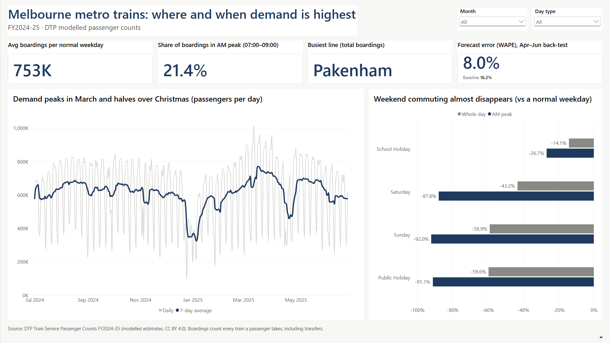
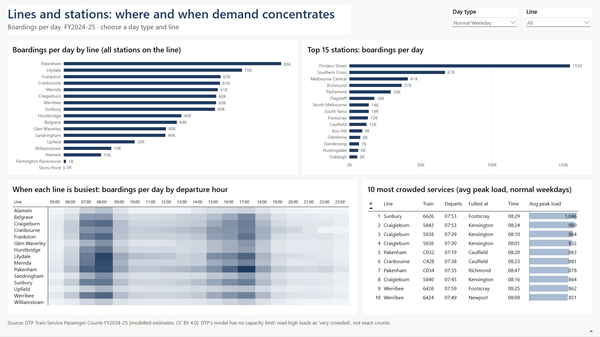
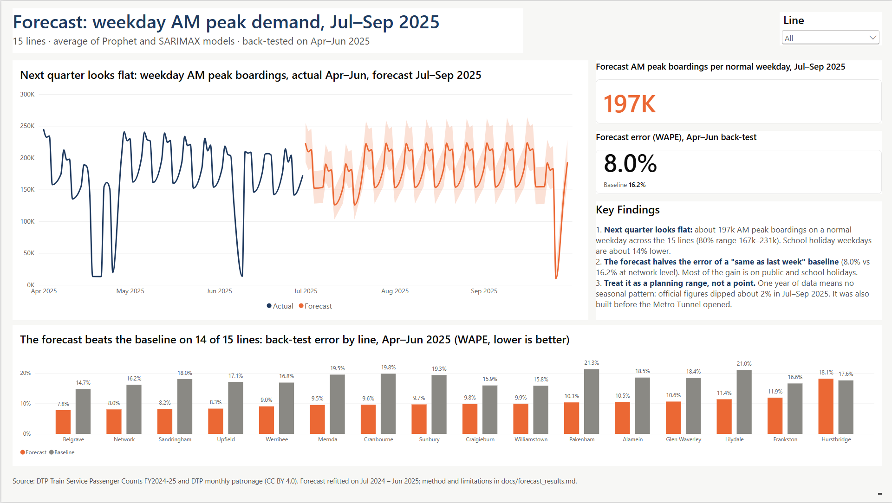

# Melbourne Metro Train Demand Analysis

**Where and when is demand on Melbourne's metropolitan train network highest, and what will weekday peak demand look like over the next quarter, by line?**

An end-to-end analysis of 15.9 million rows of public train passenger data. Raw CSVs are loaded into **Snowflake** and checked by **SQL** data quality tests. A **Python** forecast is back-tested against a baseline, and the results are presented in a **Power BI** dashboard and a one-page summary for a planning manager.



## Key findings

| # | Finding | Number |
|---|---|---|
| 1 | **Next quarter's weekday AM peak is flat, and the forecast halves the error of a "same as last week" baseline** | ~197k boardings per normal weekday (80% range 167k–231k); back-test error **8.0% vs 16.2%** |
| 2 | **Hybrid work has reshaped the week: the Friday morning peak is a third smaller than Tuesday's** | AM peak index: Tuesday **114**, Friday **76** (100 = average weekday) |
| 3 | **Crowding is concentrated on a few inbound trains, 07:19–07:59 departures,** peaking at Footscray, Kensington, Caulfield and Richmond | Busiest: Sunbury 07:53, avg peak load **~1,046** at Footscray |
| 4 | **School holidays cut commuting by a quarter; weekends almost remove it** | AM peak: school holidays **−27%**, Sunday **−92%** vs a normal weekday |
| 5 | **March is the busiest month, every year** | March 2025 **+16%** above the year's average weekday; peak month every year from 2018 to 2026 in DTP's official data |

**More detail:**
- The full write-up, with recommendations, is in [docs/insight_summary.md](docs/insight_summary.md).
- All seven analysis questions are answered in [docs/analysis_findings.md](docs/analysis_findings.md).

## Forecast results

Weekday AM peak (07:00–08:59) boardings for 15 lines were forecast for 1 Apr – 30 Jun 2025, using only data up to 31 March, and scored against what actually happened.

| Model | Network error (WAPE) | All line-days (WAPE) | Lines beating the baseline |
|---|---|---|---|
| Baseline: same weekday, last week of March | 16.2% | 18.3% | — |
| Prophet | 9.0% | 11.8% | 14 of 15 |
| SARIMAX | 7.3% | 9.9% | 15 of 15 |
| **Ensemble (average of both): used for the forecast** | **8.0%** | **10.5%** | **14 of 15** |

- **Where the gain comes from:** mostly holidays, which the baseline can't anticipate. On normal weekdays the ensemble is moderately better (9.8% vs 12.3%).
- **Why the ensemble:** validation ranked Prophet first and the test ranked SARIMAX first. Picking the test winner would have meant choosing on the test.
- **Honest testing:** every model setting was fixed before the test period was scored. A second version of each model was adopted only if it did better on a validation period inside the training data, which rejected one of them.
- **Checked against reality:** for Jul–Sep 2025, DTP's official patronage came in about 3 index points below the flat forecast. That's within the precision of the comparison.

Full method and limitations: [docs/forecast_results.md](docs/forecast_results.md).


## How it works

```
DataVic CSVs (2.8 GB)          Snowflake (SQL)                      Python             Power BI
──────────────────────   ──────────────────────────────────   ─────────────────   ──────────────
Passenger counts     ─┐   RAW      all text, loaded as-is       Prophet + SARIMAX   3-page dashboard
Station entries      ─┼─▶ STAGING  typed, cleaned, Metro only ─▶ back-test, 13-week ─▶ 24 DAX measures
Monthly patronage    ─┤   MART     analysis tables, lookups     forecast, written   star schema
Calendar (built)     ─┘            8 data quality checks        back to Snowflake
```

| Step | Files |
|---|---|
| **1. Load:** a 2.8 GB CSV uploaded with Snowflake CLI (`PUT` + `COPY INTO`), all columns as text | [sql/01_setup.sql](sql/01_setup.sql), [sql/02_load_raw.sql](sql/02_load_raw.sql) |
| **2. Clean:** type casting with `TRY_` functions, Metro Trains only, time bands and 30-minute blocks | [sql/03_staging.sql](sql/03_staging.sql) |
| **3. Validate:** 8 data quality checks, including duplicates, load continuity between stops, reconciliation to station entries and comparison with official patronage | [sql/04_data_quality_checks.sql](sql/04_data_quality_checks.sql) |
| **4. Model:** mart tables at the right grain, window functions (`RANK() OVER`, 7-day moving average) | [sql/05_marts.sql](sql/05_marts.sql), [sql/06_analysis.sql](sql/06_analysis.sql) |
| **5. Forecast:** disruption-day detection, holiday-aware models, validation, back-test, write-back with `write_pandas` | [notebooks/forecast_weekday_peak.ipynb](notebooks/forecast_weekday_peak.ipynb) |
| **6. Present:** Power BI star schema, DAX measures, 3 pages | [powerbi/](powerbi/), [sql/07_powerbi.sql](sql/07_powerbi.sql), [docs/powerbi_build_guide.md](docs/powerbi_build_guide.md) |

### Dashboard

| Lines and stations | Forecast |
|---|---|
|  |  |

The `.pbix` file and a PDF export are in [powerbi/](powerbi/).

## Data quality and limitations

Every check, finding and decision is logged in [docs/data_quality_notes.md](docs/data_quality_notes.md).

**What the checks found:**
- **All 15.9M rows loaded and typed** with no failures.
- **The true row key:** it needs the stop sequence, because trains call at Flinders Street twice when they go round the City Loop.
- **Passenger loads carry over exactly** from one stop to the next on all 13.7M stop pairs.
- **The weekly and monthly patterns match DTP's official myki-based patronage** (correlation 0.999).

**Limitations:**
- **Modelled counts, with transfers counted twice.** The source is DTP's modelled estimates, and a passenger who changes trains counts as two boardings. Hubs such as Flinders Street and Richmond are therefore inflated, and individual train loads are indicative, not exact (the model has no capacity limit).
- **One year of data, all before the Metro Tunnel opened.** The forecast can't learn yearly seasonality, and line patterns on Sunbury, Pakenham and Cranbourne may now differ.
- **Some quiet lines are understated.** Stony Point, Alamein and Williamstown have many stop records with no data. Stony Point and Flemington Racecourse are left out of the forecast.

## Tools

Snowflake (SQL, Snowflake CLI) · Python 3.14 (pandas, Prophet, statsmodels, matplotlib, snowflake-connector-python) · Jupyter · Power BI Desktop (DAX) · Git

**To reproduce:**
1. Download the source files listed below into `data/raw/`.
2. Run the SQL scripts in order with `snow sql -c <connection> -f sql/0X_….sql`.
3. Install the Python packages with `pip install -r requirements.txt`, then run the notebook.
4. Open the `.pbix` and point it at your own Snowflake account.

## Data sources

All from the Victorian Department of Transport and Planning, licensed under [CC BY 4.0](https://creativecommons.org/licenses/by/4.0/):
- [Train Service Passenger Counts](https://discover.data.vic.gov.au/dataset/train-service-passenger-counts), FY2024-25
- [Annual metropolitan train station patronage (station entries)](https://discover.data.vic.gov.au/dataset/annual-metropolitan-train-station-patronage-station-entries), FY2024-25
- [Monthly average patronage by day type and by mode](https://discover.data.vic.gov.au/dataset/monthly-average-patronage-by-day-type-and-by-mode)

Calendar of Victorian public holidays and school terms: built by [scripts/build_calendar.py](scripts/build_calendar.py), from data.gov.au and vic.gov.au.

---

*Dylan Kapadia · [LinkedIn](https://www.linkedin.com/in/dylan-kapadia/) · October 2026*
