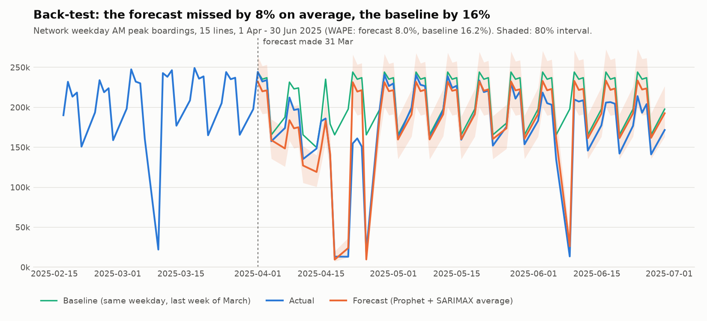
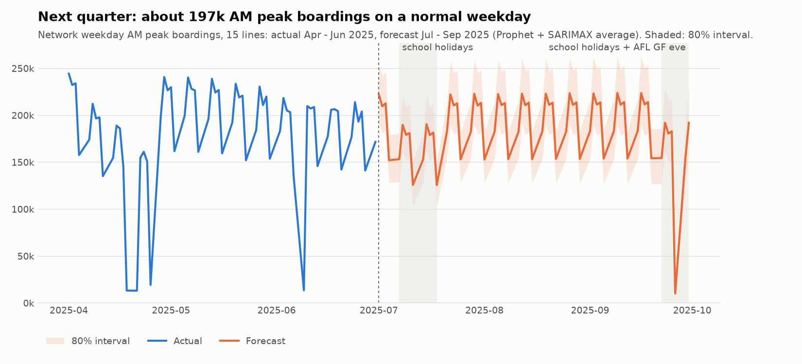

# Forecast results: weekday AM peak demand by line

**Question:** what will weekday AM peak (07:00–08:59) boardings look like over the next quarter, line by line?

- **Notebook:** `notebooks/forecast_weekday_peak.ipynb`. It runs top to bottom in about 4 minutes and writes its results to Snowflake.
- **Snowflake tables for Power BI:** `MART.FORECAST_LINE_DEMAND`, `MART.FORECAST_BACKTEST`, `MART.FORECAST_METRICS`.
- **Charts:** `images/forecast_backtest.png`, `images/forecast_next_quarter.png`.
- **Status:** 17 Oct 2026. Checked against the Power BI forecast page: the outlook (197K), the network error (8.0% vs 16.2%) and all 32 per-line error values match.

## Summary

| | Result |
|---|---|
| **Accuracy (back-test, Apr–Jun 2025)** | Missed by **8.0%** at network level (WAPE), against **16.2%** for a "same as last week" baseline. Across all line-days, 10.5% against 18.3% |
| **Lines beating the baseline** | **14 of 15.** The exception is Hurstbridge (18.1% vs 17.6%) |
| **Next-quarter outlook (Jul–Sep 2025)** | About **197k** AM peak boardings on a normal weekday across the 15 lines (80% range 167k–231k), flat on Apr–Jun. School holiday weekdays: about 170k |
| **Check against reality** | Official patronage dipped about 2.4% in Jul–Sep, and the forecast was flat, so it ran about 3 points high. That's within the precision of the comparison |

## Method

**Target.** Daily AM peak boardings, Monday to Friday, for each of the **15 forecast lines**.
- Left out: Stony Point (too many stop records with no data), Flemington Racecourse (event days only) and the City Loop short services (not a corridor line).
- These choices are set in `MART.DIM_LINE`; see `docs/data_quality_notes.md`.

**Disruption days are left out of training.** A line-day counts as disrupted when the line was closed, or when AM peak **services and boardings were both under 80%** of the line's usual level for that day type.
- Training: 39 line-days (1.3%). Test period: 14 (1.4%).
- They include the Metro Tunnel testing closures of 14–17 Apr 2025.
- Scores exclude them, because no model can foresee a closure. Results including them are in the notebook.

**Calendar features.** All of these are known in advance:
- **Public holidays:** one shared effect. None of the four test-period holidays appears in the training data.
- **School holidays.**
- **The Christmas–New Year shutdown** (23 Dec – 3 Jan), with a separate effect for each day.
- **Two one-off quiet days:** the Monday before Melbourne Cup, and the last Friday before Christmas.

**Time split.**

| Period | Dates | Use |
|---|---|---|
| Training | 1 Jul 2024 – 31 Mar 2025 | Fit the models |
| Validation | Train to 31 Jan, forecast 3 Feb – 31 Mar 2025 | Choose between model versions, without touching the test |
| Test | 1 Apr – 30 Jun 2025 | Score the models once, forecasting the full 13 weeks in one go from 31 Mar |
| Forecast | 1 Jul – 30 Sep 2025 | Refit on the full year, forecast 66 weekdays |

**Models.**

| Model | What it is |
|---|---|
| Seasonal naive (baseline) | Each line's last known value for the same weekday before the cut-off, repeated forward |
| Prophet (v1) | Trend + weekly pattern + calendar effects. Conservative trend (changepoint prior 0.01), because the March peak is seasonal, not growth |
| SARIMAX (v2) | ARMA(1,1) with a weekly seasonal ARMA(1,1), day-of-week effects and calendar flags, on a log scale |
| **Ensemble (used for the forecast)** | The average of Prophet v1 (floored at zero) and SARIMAX v2. Its interval is the average of the two models' 80% bounds |

**Scores.**
- **MAE:** average miss, in boardings per line per day.
- **WAPE:** total miss ÷ total boardings. This is the headline % score.
- **MAPE:** the average % miss per day. It explodes on public holidays, when quiet lines carry only 10–60 AM peak passengers, so it's reported by day type only.

## How the models were chosen

1. **Version 1 had two build problems.**
   - Its holiday effect was additive (about "180k fewer passengers"), which produced **negative** forecasts for Good Friday and ANZAC Day.
   - SARIMAX's weekly pattern faded over a long forecast.
2. **Version 2 fixed how the models were built:**
   - a log scale, so every effect is a percentage
   - day-of-week effects for SARIMAX
   - Christmas-period holidays separated from the shared holiday effect
3. **A validation rule, set before the test was run:** use version 2 only if its validation WAPE is no worse than version 1's.

| Model | Validation WAPE | Decision |
|---|---|---|
| Prophet v1 | **16.3%** | Kept |
| Prophet v2 | 22.2% | Rejected: the log-scale trend climbed and over-forecast every line by 30–55% |
| SARIMAX v1 | 33.3% | Rejected |
| SARIMAX v2 | **17.4%** | Kept |

4. **SARIMAX refit on 3 lines.** On Cranbourne, Mernda and Pakenham the default fit stopped before converging. Refitting with more iterations or the Powell optimiser moved those forecasts by 5–15% and lowered their error. All scores below use the converged fits; the before/after table is in the notebook.
5. **Why the ensemble.** Validation ranked Prophet first and the test ranked SARIMAX first, so neither is consistently better. Picking the test winner would mean choosing on the test, so the forecast uses the **average of the two**.
6. **Two choices made in advance held up:**
   - **The conservative trend.** In the first run, Prophet with its default trend setting carried the March rise forward and scored 27.2% WAPE on the test, against 11.8% for the conservative setting.
   - **The validation rule.** It caught Prophet v2 before it reached the test.

## Back-test results (1 Apr – 30 Jun 2025, disrupted days excluded)

**WAPE by type of day, all 15 lines:**

| Model | All days | Normal weekdays | School holidays | Public holidays |
|---|---|---|---|---|
| Baseline (seasonal naive) | 18.3% | 12.3% | 15.7% | 1,126% |
| Prophet v1 | 11.8% | 10.6% | 15.0% | 126% |
| SARIMAX v2 | 9.9% | 9.4% | 12.1% | 38% |
| **Ensemble** | **10.5%** | **9.8%** | **13.5%** | **64%** |

- **Most of the gain is on holidays.** On normal weekdays the ensemble is only moderately better than the baseline (9.8% vs 12.3%). The baseline predicts a full commuter peak on Good Friday, so its public holiday error is enormous.
- **Public holidays, network AM peak:**

| Holiday | Actual | Ensemble | SARIMAX v2 | Prophet v1 | Baseline |
|---|---|---|---|---|---|
| Good Friday | 13,280 | 9,574 | 17,548 | −3,864 | 165,640 |
| Easter Monday | 13,170 | 24,004 | 21,061 | 26,883 | 197,800 |
| ANZAC Day | 19,330 | 9,734 | 17,510 | −3,293 | 165,640 |
| King's Birthday | 13,530 | 26,147 | 20,967 | 30,879 | 197,800 |

*Prophet v1 is shown as it ran. The ensemble floors it at zero.*

**WAPE by line (all days):**

| Line | Ensemble | Prophet v1 | SARIMAX v2 | Baseline |
|---|---|---|---|---|
| Belgrave | 7.8% | 8.3% | 7.5% | 14.7% |
| Sandringham | 8.2% | 10.0% | 7.2% | 18.0% |
| Upfield | 8.3% | 8.6% | 8.4% | 17.1% |
| Werribee | 9.0% | 9.3% | 8.9% | 16.8% |
| Mernda | 9.5% | 10.9% | 8.4% | 19.5% |
| Cranbourne | 9.6% | 10.0% | 10.1% | 19.8% |
| Sunbury | 9.7% | 10.7% | 8.9% | 19.3% |
| Craigieburn | 9.8% | 10.3% | 9.9% | 15.9% |
| Williamstown | 9.9% | 11.8% | 9.8% | 15.8% |
| Pakenham | 10.3% | 10.9% | 10.3% | 21.3% |
| Alamein | 10.5% | 11.3% | 11.5% | 18.5% |
| Glen Waverley | 10.6% | 10.7% | 11.0% | 18.4% |
| Lilydale | 11.4% | 12.9% | 10.1% | 21.0% |
| Frankston | 11.9% | 15.2% | 9.4% | 16.6% |
| Hurstbridge | 18.1% | 21.0% | 16.0% | 17.6% |
| **Network total** | **8.0%** | 9.0% | 7.3% | 16.2% |

**Intervals.** The ensemble's 80% interval held **79%** of actual values, which is well calibrated. Prophet's own interval held only 58%: too narrow.

**Known miss: the Easter–ANZAC working days.** Tue–Thu 22–24 April 2025 fall between Easter Monday and ANZAC Day. They ran about 26% below a normal week, and the ensemble over-forecast them by **36–49%**. Nothing like this occurs in the training year, so no model could learn it.

## Outlook: 1 Jul – 30 Sep 2025

**Average normal-weekday AM peak boardings, ensemble forecast:**

| Line | Apr–Jun actual | Jul–Sep forecast | 80% range | Change |
|---|---|---|---|---|
| Pakenham | 19,311 | 18,983 | 15,741–22,742 | −2% |
| Lilydale | 18,859 | 19,059 | 15,934–22,672 | +1% |
| Mernda | 18,356 | 18,168 | 15,231–21,502 | −1% |
| Frankston | 17,020 | 17,209 | 14,428–20,373 | +1% |
| Werribee | 16,289 | 16,405 | 14,356–18,633 | +1% |
| Craigieburn | 16,257 | 16,291 | 14,118–18,718 | 0% |
| Hurstbridge | 15,289 | 14,576 | 12,171–17,307 | −5% |
| Sunbury | 14,759 | 14,409 | 12,311–16,809 | −2% |
| Cranbourne | 12,528 | 12,400 | 10,371–14,741 | −1% |
| Belgrave | 11,602 | 11,702 | 10,122–13,460 | +1% |
| Sandringham | 10,735 | 10,835 | 9,458–12,386 | +1% |
| Glen Waverley | 10,241 | 10,357 | 8,909–11,971 | +1% |
| Upfield | 6,334 | 6,410 | 5,562–7,346 | +1% |
| Alamein | 5,400 | 5,484 | 4,330–6,974 | +2% |
| Williamstown | 4,663 | 4,735 | 3,891–5,764 | +2% |
| **Network (15 lines)** | **197,644** | **197,024** | **166,935–231,397** | **0%** |

*The network row is the sum of the line forecasts and of their interval bounds. Summing bounds overstates the network range, because lines don't move independently.*

**By type of day (network):**

| Day type | Weekdays | Forecast | 80% range |
|---|---|---|---|
| Normal weekday | 49 | 197k | 167k–231k |
| School holiday (7–18 Jul, from 22 Sep) | 16 | 170k | 142k–201k |
| AFL Grand Final eve (Fri 26 Sep) | 1 | 10k | 6k–23k |

The AFL Grand Final eve forecast is **probably too low**. The same holiday carried 26.9k in 2024, but the shared holiday effect treats it like Good Friday.

## Check against what actually happened

**Why only at network level.** DataVic hadn't published FY2025-26 passenger counts by October 2026, so the forecast can't yet be checked line by line.

**What was compared.** DTP's official monthly patronage (myki and barrier data; data quality check 8) does cover Jul–Sep 2025. The two measure different things: AM peak boardings on 15 lines vs all-day entries across the network. So both are indexed to their own Apr–Jun 2025 average (normal weekdays).

| Month | Forecast index | Official index | Gap (points) |
|---|---|---|---|
| Jul 2025 | 100.1 | 96.2 | +3.8 |
| Aug 2025 | 100.4 | 100.4 | −0.1 |
| Sep 2025 | 100.6 | 96.2 | +4.5 |
| **Jul–Sep** | **100.4** | **97.6** | **+2.8** |

- **The forecast ran about 3 points high.** It expected a flat quarter, and patronage dipped 2.4%, mostly in July and September.
- **The gap is within the comparison's precision.** In the months where both sides are actuals, the two measures differ by −3.6 to +3.3 points. So the forecast is consistent with the outcome, but it can't anticipate seasonal dips: with one year of data it has no yearly pattern. For reference, Jul–Sep 2024 came in at 99.8 against Apr–Jun 2024.
- **July school holidays were close:** forecast at 84.6% of an Apr–Jun normal weekday, against 81.7% officially.

## Limitations

- **One year of data.** No yearly pattern can be learned, so the forecast is flat across the seasons: no March peak, no winter dip.
- **Before the Metro Tunnel.** All the data comes from before the Metro Tunnel opened, so the line patterns of Sunbury, Pakenham and Cranbourne may have changed since.
  - **To use this model after the opening:** treat the opening as a **structural break**. Retrain on post-opening data only, once a few months exist.
  - **Until then:** forecast at network or corridor level, or apply scenario adjustments, such as shifting a share of demand between lines, and state them as assumptions.
- **Modelled counts.** The input is DTP's modelled estimates. They're validated against official totals for shape (check 8), not for exact levels.
- **One shared holiday effect.** Holidays that run busier than usual (AFL Grand Final eve, Boxing Day) are under-forecast.
- **Hurstbridge level shift.** From October 2024 to March 2025, Hurstbridge ran about 15% below its Jul–Sep level, then recovered in April. Every other line moved the other way. The models learned the low level and under-forecast Hurstbridge by 13–19%. The cause isn't established.
- **Unprecedented weeks are missed,** such as the Easter–ANZAC working days.
- **Prophet's own intervals are too narrow** (58% coverage). The ensemble interval is better (79%), but it's an approximation, not a formal interval.

## Next step: add a second year of data

DataVic publishes Train Service Passenger Counts back to **FY2018-19**. Adding **FY2023-24** (another ~2.8 GB file, about 1–2 hours to load, stage and refit) would:
- give every public holiday its **own effect**, because Good Friday, ANZAC Day and King's Birthday would then appear in training;
- let the model learn the **yearly pattern**: the March peak (+8% to +16% every year in the official data) and the winter dip;
- double the training data for the disruption rule and the validation period.
